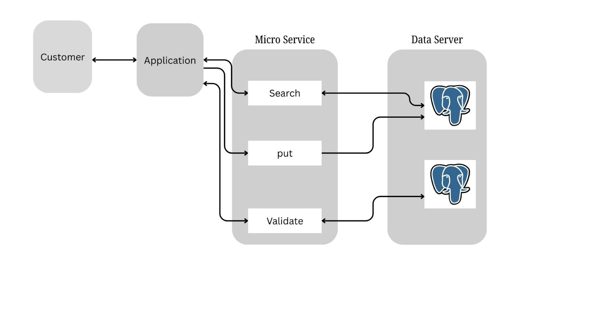

# FrostByte Logistics API (bcf2026)

A team hackathon project for **BCF 2026**: a backend API for a **cold-chain logistics network**. It models producers, warehouses with temperature-controlled storage units, customers (hospitals and retailers), products with temperature requirements, shipping routes, and daily demand — and validates whether the network can feasibly and safely satisfy that demand.

The project is containerized with **Docker Compose** (Node.js server + PostgreSQL).

## Architecture



A client application talks to the service layer, which is split into **Search**, **Put** (create) and **Validate** operations backed by PostgreSQL.

## Tech stack

- **Node.js 18** + **Express 4**
- **PostgreSQL 15** (via `pg` connection pool)
- **Docker** & **Docker Compose**

## Project structure

```
.
├── docker-compose.yaml          # db (postgres:15-alpine) + server (Node.js)
├── database/init.sql            # Schema loaded on first DB start
├── docs/
│   ├── Architechture/microservices.jpeg
│   └── database/
│       ├── schemas.md           # Table-by-table schema documentation
│       └── schemas.sql
└── server/
    ├── server.js                # Express entry point
    ├── Dockerfile
    ├── config/database.js       # PostgreSQL pool (env-configurable)
    ├── routes/                  # Express routers per resource
    ├── controllers/             # Request handling
    ├── services/                # Business logic & validation
    ├── models/                  # SQL data-access classes
    └── middlewears/             # Error handling (placeholder)
```

## API endpoints

| Method | Endpoint | Description |
|--------|----------|-------------|
| `GET`  | `/` | Service info / health |
| `POST` / `GET` | `/locations` | Create / list locations |
| `POST` / `GET` | `/products` | Create / list products |
| `POST` / `GET` | `/storage-units` | Create / list storage units |
| `POST` / `GET` | `/routes` | Create / list routes |
| `POST` / `GET` | `/demands` | Create / list demands |
| `GET`  | `/network/summary` | Everything in the network in one response |
| `POST` | `/temps/validate` | Check that every demand can be served from a warehouse with a temperature-compatible storage unit |
| `POST` | `/network/validate` | Check network feasibility for a date (`{ "date": "YYYY-MM-DD" }`) |

### Validation logic (`server/services`)

- **Temperature validation:** for each demand on a date, finds warehouse routes into the customer's location and checks that at least one storage unit's temperature range fully contains the product's required range.
- **Network validation:** groups demand per location and checks route **minimum-shipment** and **maximum-capacity** constraints, plus **storage-unit capacity**, returning a list of issues or `{ "feasible": true }`.

## Database schema

Defined in [`database/init.sql`](database/init.sql) and documented in [`docs/database/schemas.md`](docs/database/schemas.md):

- `Producer`, `Warehouse`, `Customer` (type: `Hospital` | `Retailer`)
- `Storage` — storage units per warehouse with `minTemp`, `maxTemp`, `capacity`
- `Product` — with `minTemp` / `maxTemp`
- `ProductionRoutes` (producer → warehouse) and `DeliveryRoutes` (warehouse → customer), each with `capacity` and `minShipment`
- `Demand` — per customer, product and date, with `minQuantity` / `maxQuantity`

## Running

```bash
docker-compose up --build
```

- API: <http://localhost:8000>
- PostgreSQL: `localhost:5432` (user `postgres`, password `postgres`)

The server reads `DB_HOST`, `DB_PORT`, `DB_USER`, `DB_PASSWORD`, `DB_NAME` and `PORT` from the environment (set in `docker-compose.yaml`).

## Status

This was built under hackathon time pressure. The `server.js` that ships in the Docker image currently serves **stub responses** for every endpoint. The layered implementation (`routes/` → `controllers/` → `services/` → `models/`) is in the repository but not yet wired into `server.js`, and the models target a slightly different table layout (`locations`, `routes`, `storage_units`, …) than `init.sql`. A packaged copy of the models is also in `server/models.zip`.

## Contributors

- [@sarwarxsami](https://github.com/sarwarxsami)
- [@RabiulHasanReza](https://github.com/RabiulHasanReza)

---

> **Note:** This README.md was generated by an LLM (large language model) from an analysis of the repository's contents.
